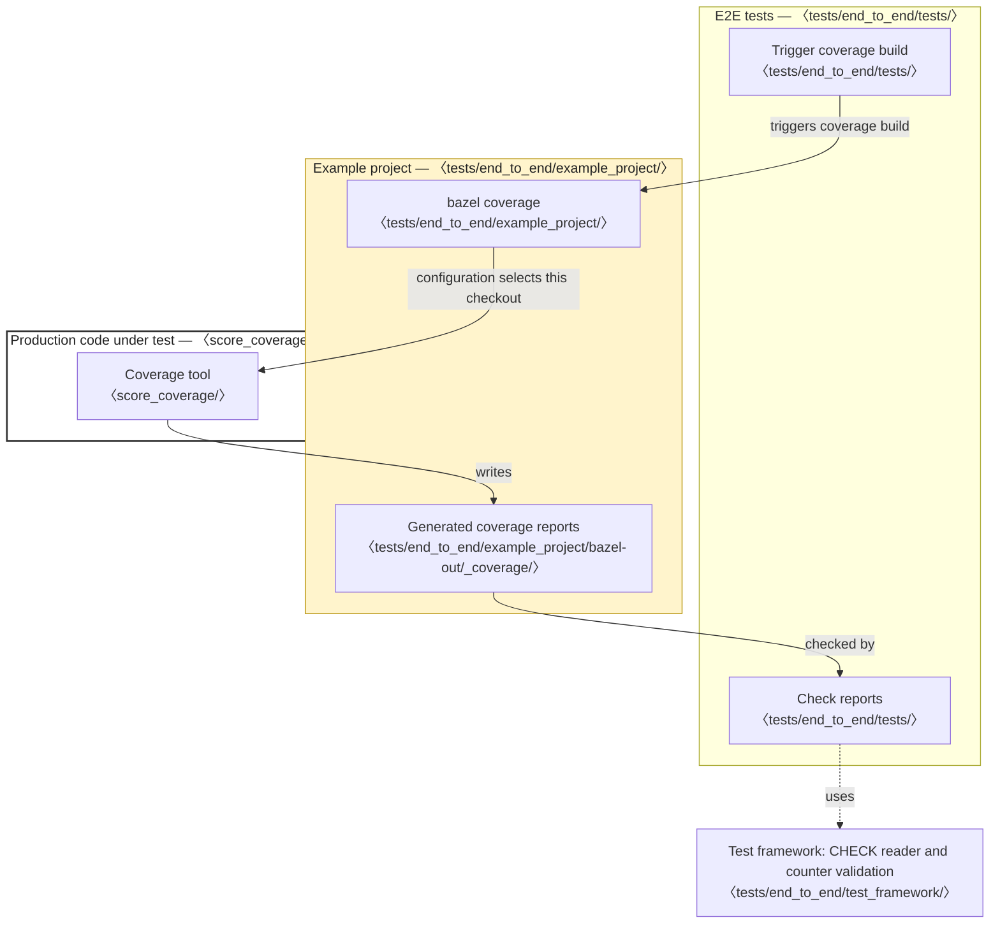

<!-- ----------------------------------------------------------------------------
  Copyright (c) 2026 Contributors to the Eclipse Foundation

  See the NOTICE file(s) distributed with this work for additional
  information regarding copyright ownership.

  This program and the accompanying materials are made available under the
  terms of the Apache License Version 2.0 which is available at
  https://www.apache.org/licenses/LICENSE-2.0

  SPDX-License-Identifier: Apache-2.0
----------------------------------------------------------------------------- -->

# End-to-end tests

These tests use the coverage tool as another project would: build and run
example code with Bazel, then check the generated reports. This protects the
tool's observable behavior while we refactor its implementation.

The diagram shows the coverage-build scenarios. A few CLI tests invoke the
executable directly with isolated inputs instead. Paths in 〈…〉 are relative
to the repository root.



- [`example_project/`](example_project) is a small, independent Bazel project
  whose `MODULE.bazel`, `.bazelrc` and `tools/coverage/BUILD` configure coverage
  using this checkout. Its C++ and Rust tests produce the measurements.
- [`tests/`](tests) contains the Python E2E tests. They run the example project
  and check coverage counts, included files, HTML, archives and CLI exit codes.
- [`test_framework/`](test_framework) reads CHECK comments and validates LCOV
  counters. Its **unit tests** check these helpers without running the tool.

For example, the C++ scenarios run two tests that take opposite branches.
The reports must show the expected counts for each test and their combined
run. Expected counts are written beside the C++ code as `CHECK` comments.
The same scenarios run with Clang/LLVM and GCC/gcov on Linux.

Run from the repository root:

```sh
# End-to-end tests
bazel test //tests/end_to_end/tests:all --test_output=errors

# Unit tests of the test helpers
bazel test //tests/end_to_end/test_framework:coverage_checks_test
```
